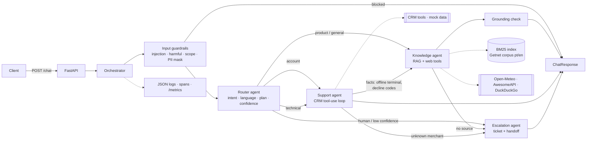

# Getnet Multi-Agent Support System

A multi-agent assistant for Getnet merchants behind one HTTP endpoint. A **Router** reads each message and
sends it to the right specialist: a **Knowledge** agent (RAG over Getnet's website + live web tools), a
**Customer Support** agent (CRM tools via an LLM tool-use loop) and an **Escalation** agent (ticket + human
handoff). Guardrails, structured traces, Prometheus metrics and an evaluation set with a CI gate are built in.

Built with **Spec-Driven Development** (GitHub Spec Kit layout): constitution → spec → plan → tasks → code.
The git history is the timeline (see [SDD timeline](#sdd-timeline)).

> Runs fully **offline** (deterministic, no API key, no network) and switches to **Claude** when a key exists
> (`claude-haiku-5-5` for routing, `claude-sonnet-5-5` for the agents). If Claude fails, it falls back to the
> offline path automatically.

---

## 1. Quick start (one command)

Prerequisite: [Docker Desktop](https://www.docker.com/products/docker-desktop/) running.

```bash
git clone https://github.com/maathmartins-ux/getnet-agents-sdd.git
cd getnet-agents-sdd
docker compose up -d --build
```

Wait ~10 s for the container to become healthy, then:

```bash
curl -s http://localhost:8000/health
```

```bash
curl -s -X POST http://localhost:8000/chat -H "Content-Type: application/json" -d "{\"message\": \"When will the money from yesterday's sales be deposited?\", \"user_id\": \"cliente1988\"}"
```

Interactive docs (try every endpoint in the browser): <http://localhost:8000/docs>. Stop with `docker compose down`.

### Use Claude instead of the offline engine (optional)

```bash
cp .env.example .env
```

Edit `.env`: set `LLM_PROVIDER=anthropic` and `ANTHROPIC_API_KEY=sk-ant-...`, then `docker compose up -d --build`.
`GET /health` shows `"mode": "anthropic"`.

### Configuration (`.env`)

| Variable | Default | Meaning |
|---|---|---|
| `LLM_PROVIDER` | `offline` | `offline` (deterministic) or `anthropic` |
| `ANTHROPIC_API_KEY` | — | needed only for `anthropic` |
| `ROUTER_MODEL` / `AGENT_MODEL` | `claude-haiku-5-5` / `claude-sonnet-5-5` | models per role |
| `LLM_TIMEOUT_S` / `LLM_MAX_RETRIES` | `20` / `2` | per-call timeout and SDK retries |
| `ENABLE_WEB_TOOLS` | `true` | weather / FX / web search; `false` returns `error="disabled"` |
| `GETNET_TODAY` | today | fixes "today" (YYYY-MM-DD) for reproducible settlement dates |
| `RETRIEVAL_MIN_SCORE` | `0.35` | minimum normalised BM25 score for a source to count |
| `ROUTER_MIN_CONFIDENCE` | `0.45` | below this the Escalation agent is added |
| `GROUNDING_THRESHOLD` | `0.6` | share of answer words that must appear in sources |

### Run without Docker

Python 3.11+:

```bash
python -m pip install -e ".[dev]"
```

```bash
uvicorn getnet_agents.api:app --reload --app-dir src
```

### Tests and evaluation

```bash
python -m pytest
```

```bash
python evals/run_evals.py
```

Inside Docker (same image, offline, no network): `docker compose --profile test run --rm test`.

Against the running container, the 10 scenarios of the case over HTTP:

```bash
python scripts/smoke_cases.py evals/dataset.jsonl smoke_results.json
```

---

## 2. Architecture



| Agent | Responsibility | LLM mode | Offline mode |
|---|---|---|---|
| **Router** (`agents/router.py`) | intent (7 labels), language, ordered plan, confidence | Claude Haiku returns JSON | weighted regex rules |
| **Knowledge** (`agents/knowledge.py`) | Getnet product answers with citations; general questions via web tools | Claude Sonnet writes from numbered passages, cites `[n]` | extractive: best sentences of top passages |
| **Support** (`agents/support.py`) | merchant data: settlements, transactions, terminals, profile | Claude Sonnet tool-use loop over CRM tools | deterministic tool planner + templates |
| **Escalation** (`agents/escalation.py`) | ticket + human handoff | deterministic by design | same |

### Design choices (ADRs in [plan.md](specs/001-multi-agent-support/plan.md))

- **In-process function calls over typed messages.** Router → `RoutingDecision`, agents → `AgentResult`
  (`answer`, `sources`, `tool_calls`, `facts`, `needs_handoff`). Deterministic and traceable; a queue
  would add moving parts with no benefit at this scale. Swap point: the loop in `Orchestrator._handle`.
- **The plan comes from code, not from the LLM.** Claude classifies; `PLANS[intent]` decides which agents run.
  Routing stays testable and an LLM hallucination cannot invent a route.
- **Two providers behind one interface.** `OfflineLLM` (default + fallback) and `AnthropicLLM`. Tests and CI
  never need a key.
- **BM25 with field weights instead of a vector DB.** About 30 documents; BM25 is exact, explainable and has no
  dependencies. Swap point: `KnowledgeStore.search(query, lang, k)`.
- **Escalation is an agent, not an error path.** It is planned (human request), appended on low confidence, or
  triggered by another agent (`needs_handoff`).

## 3. Message workflow

1. `POST /chat` validates `{message (1–2000 chars), user_id}` and gets a `trace_id`.
2. **Input guardrails**: CPF, CNPJ, card numbers (Luhn-checked), e-mail and phone are masked *before* any agent,
   LLM or log sees them. Prompt injection and fraud requests → `unsafe`; off-topic → `out_of_scope`;
   both are answered with a polite refusal and route `["router"]`.
3. **Router** classifies → e.g. `technical_support`, `en`, plan `router → support → knowledge`, confidence 0.83.
4. **Support** calls `get_terminal_status` / `get_recent_transactions` (the `user_id` is always overwritten with
   the caller's, so the model can't read another merchant's data). Its `facts` (offline terminal, decline codes)
   enrich the **Knowledge** query, which retrieves the troubleshooting pages.
5. Any `needs_handoff` (no source, unknown merchant, CRM down) or confidence < 0.45 → **Escalation** opens a ticket.
6. Output: answers are joined, PII is masked again, sources deduplicated, metrics recorded.

Response (example, abridged):

```json
{
  "trace_id": "7f0c…", "intent": "technical_support", "language": "en", "confidence": 0.825,
  "route": ["router", "support", "knowledge"],
  "answer": "Your Get Clássica (T-1988-02) is offline … According to Getnet's official content: … [1]",
  "sources": [{"title": "…", "url": "https://site.getnet.com.br/…", "score": 0.71}],
  "tool_calls": [{"name": "get_terminal_status", "args": {"user_id": "cliente1988"}, "ok": true, "latency_ms": 0.9}],
  "handoff": null, "guardrail": null, "mode": "offline", "latency_ms": 3.1
}
```

## 4. RAG pipeline (ingestion → storage → retrieval → generation)

| Stage | Where | What |
|---|---|---|
| **Ingestion** | `rag/ingest.py`, `data/knowledge/` | Official pages (getnet.net/en, getnet.net, site.getnet.com.br product, FAQ, help-centre pages and the Get Clássica / Get Smart manuals) were fetched and curated into two sources, each fact tied to its URL: `corpus.jsonl` (15 topics × pt/en) and 15 topic sheets `*.md` (front matter with `source_url` and keywords, split into one document per `##` section, each with an English summary). Provenance: `data/knowledge/README.md` and `SOURCES.md`. Total index: **129 documents**. `python -m getnet_agents.rag.ingest --refresh` re-crawls `sources.json` live (HTML → text → 180-word chunks) into `corpus.live.jsonl`. |
| **Storage** | `rag/store.py` | In-memory inverted index; tokens are lower-cased, accent-folded, stop-word filtered, plural-folded. |
| **Retrieval** | `KnowledgeStore.search` | BM25 per field (title ×3, tags ×2, text ×1), same-language documents preferred, score normalised to 0–1, `RETRIEVAL_MIN_SCORE` filter. |
| **Generation** | `agents/knowledge.py` + `prompts/knowledge.md` | Claude answers only from numbered passages, cites `[n]`, replies `NOT_IN_SOURCES` otherwise (→ handoff). A lexical grounding check rejects unsupported answers and falls back to the extractive answer. Offline: extractive answer, grounded by construction. |

**No source, no claim (BR-01):** if no passage passes the threshold, the agent does not answer; the Escalation agent opens a ticket.

## 5. How the LLM tools are used

`tools/__init__.py` exposes `TOOL_SPECS` in Anthropic tool-use format (name, description, JSON Schema) and `run_tool()`, which never raises.

| Tool | Agent | Source |
|---|---|---|
| `get_customer_profile(user_id)` | Support | CRM (mock) |
| `get_settlement_forecast(user_id, reference_date)` | Support | CRM; business days, national holidays skipped |
| `get_recent_transactions(user_id, status, limit)` | Support | CRM |
| `get_terminal_status(user_id)` | Support | CRM |
| `open_support_ticket(user_id, category, summary)` | Escalation | CRM |
| `get_weather_forecast(city, days_ahead)` | Knowledge | Open-Meteo |
| `get_exchange_rate(base, quote)` | Knowledge | AwesomeAPI |
| `web_search(query, k)` | Knowledge | DuckDuckGo HTML |

The Support agent runs a **manual tool-use loop** (`llm.py: AnthropicLLM.tool_loop`): the model requests tools,
results go back as `tool_result` blocks (all in one user message, `is_error` on failures), up to 4 steps.
Every call is recorded in `tool_calls` with latency. Tools have a 5 s timeout and return
`{ok, data, source, error}` instead of raising.

## 6. Guardrails and human handoff

| Guardrail | Behaviour |
|---|---|
| Prompt injection (en/pt patterns) | blocked, `intent=unsafe`, `guardrail.category=prompt_injection` |
| Fraud / illegal (card cloning, stolen cards…) | blocked, `category=harmful` |
| Abusive content (insulting or threatening customers) | blocked, `category=abusive` |
| Another merchant's data ("show cliente2045's balance") | blocked, `category=data_access` |
| Off-topic (poems, jokes, homework…) without a payments term | blocked, `intent=out_of_scope` |
| PII (CPF, CNPJ, card with Luhn, e-mail, phone) | masked everywhere, `category=pii_redacted`, not blocked |
| Grounding | LLM answer must share ≥ 60 % of content words with the sources, otherwise it is replaced |
| Cross-merchant access | `user_id` in tool calls is forced to the caller's id |

Handoff happens when the merchant asks for a person, routing confidence < 0.45, there is no grounded source,
or the merchant/CRM can't be found. The response carries `handoff: {required: true, reason, ticket_id}` so the
channel (web chat, WhatsApp, Teams) can move the conversation to the human queue.

## 7. Observability

- **Structured logs**: one JSON line per span (`router`, each agent, each tool, each LLM call) with `trace_id`,
  `duration_ms`, status and attributes, plus one `request_completed` line per request. PII never reaches logs.
- **Metrics** (`GET /metrics`, Prometheus format): `getnet_requests_total{intent,outcome}`,
  `getnet_request_duration_seconds`, `getnet_span_duration_seconds{span}`, `getnet_tool_calls_total{tool,ok}`,
  `getnet_handoffs_total{reason}`, `getnet_guardrail_blocks_total{category}`, `getnet_llm_calls_total{model,status}`.
- **Production dashboard and alerts (proposal)**: handoff rate by reason, tool error rate, p95 latency per agent,
  LLM fallback rate (`status!="ok"`), guardrail blocks. Alert only on actionable signals with hysteresis,
  e.g. tool error rate > 10 % for 10 min, p95 > 5 s for 15 min, handoff rate twice the 7-day baseline.

## 8. Evaluation and testing strategy

| Layer | What | Where |
|---|---|---|
| Unit | router rules and language, BM25, ingestion, guardrails, tools (HTTP mocked), metrics | `tests/test_router.py`, `test_rag.py`, `test_guardrails.py`, `test_tools.py`, `test_observability.py` |
| Integration | orchestrator workflows: agent hand-offs, facts flow, LLM outage fallback, ungrounded LLM answer, `NOT_IN_SOURCES`, unknown merchant | `tests/test_orchestrator.py` (fake LLMs inject each failure mode) |
| Contract / API | `/chat` schema, 422 validation, `/health`, `/metrics` | `tests/test_api.py` |
| Acceptance | the 10 case scenarios + edge cases from the golden set | `tests/test_scenarios.py` |
| Container smoke | the 10 case scenarios over HTTP against the running container, live web tools | `scripts/smoke_cases.py` (`make smoke`) |
| Evaluation | golden dataset; intent/route/language accuracy, source coverage, tool recall, handoff and guardrail precision/recall, latency; **CI gate: routing ≥ 90 %** | `evals/` |

Integration testing approach: every external dependency sits behind an interface that can be replaced in tests
(LLM provider, `run_tool`, httpx client, CRM file, "today"). Each orchestration path is tested end to end with
real agents and fake dependencies, including failure modes (LLM down, tool timeout, empty retrieval). With an
API key, `python evals/run_evals.py --live` runs the same golden set against Claude and the live web tools.
In production, add LLM-as-judge scoring (faithfulness to sources, answer relevance, language) on sampled traffic
and feed failures back into the golden set.

## 9. Spec-Driven Development

| Artifact | Path |
|---|---|
| Constitution (5 articles) | [.specify/memory/constitution.md](.specify/memory/constitution.md) |
| Spec: user stories, FR/NFR/BR, contracts, 10 acceptance criteria | [specs/001-multi-agent-support/spec.md](specs/001-multi-agent-support/spec.md) |
| Plan: ADRs, architecture, workflow, RAG pipeline | [plan.md](specs/001-multi-agent-support/plan.md) |
| Data model | [data-model.md](specs/001-multi-agent-support/data-model.md) |
| Tasks linked to requirements and tests | [tasks.md](specs/001-multi-agent-support/tasks.md) |

The contracts were committed first (`schemas.py`), then three tasks ran **in parallel** by separate agents on
disjoint files (knowledge base, tools, evals), while the core was implemented against the same contracts.

### Traceability matrix

| Requirement | Module | Test |
|---|---|---|
| FR-01 API | `api.py`, `schemas.py` | `test_api.py` |
| FR-02 Router | `agents/router.py`, `prompts/router.md` | `test_router.py` |
| FR-03 RAG | `rag/ingest.py`, `rag/store.py`, `agents/knowledge.py` | `test_rag.py`, `test_scenarios.py` |
| FR-04 Web tools | `tools/web.py`, `agents/knowledge.py` | `test_tools.py`, `test_orchestrator.py` |
| FR-05 Support tools | `tools/crm.py`, `agents/support.py`, `llm.py` | `test_tools.py`, `test_orchestrator.py` |
| FR-06 Escalation | `agents/escalation.py` | `test_orchestrator.py`, `test_scenarios.py` |
| FR-07 Orchestration | `orchestrator.py` | `test_orchestrator.py`, `test_observability.py` |
| FR-08 Input guardrails | `guardrails.py` | `test_guardrails.py`, `test_scenarios.py` |
| FR-09 Grounding | `guardrails.py`, `agents/knowledge.py` | `test_guardrails.py`, `test_orchestrator.py` |
| FR-10 Response contract | `schemas.py`, `orchestrator.py` | `test_api.py` |
| FR-11 Two providers | `llm.py`, `config.py` | `test_orchestrator.py`, `test_router.py` |
| NFR-01 Offline | `config.py`, `tests/conftest.py` | whole suite |
| NFR-02 LLM resilience | `llm.py` | `test_orchestrator.py::test_llm_outage_falls_back_to_offline_path` |
| NFR-03 Tool timeouts | `tools/` | `test_tools.py` |
| NFR-04 Observability | `observability.py` | `test_observability.py`, `test_api.py` |
| NFR-05 Container | `Dockerfile`, `docker-compose.yml` | Docker smoke test (section 10), CI |
| NFR-07 Eval gate | `evals/run_evals.py` | CI workflow |
| BR-01 No source, no claim | `agents/knowledge.py` | `test_orchestrator.py::test_no_source_no_claim` |
| BR-02 Language | `agents/router.py` | `test_router.py::test_language_follows_question` |
| BR-03 Own data only | `agents/support.py` | `test_orchestrator.py` |
| BR-06 Business days | `tools/crm.py` | `test_tools.py` |
| BR-07 PII | `guardrails.py`, `orchestrator.py` | `test_guardrails.py`, `test_observability.py::test_logs_never_contain_raw_pii` |

### SDD timeline

Generated with `git log --reverse --format='%ad %s' --date=iso` (commit dates are untouched; the `docs:` commit
that adds this README comes last). Start of work (T+0): **2026-10-30 15:01:59 -03**.

| Time (-03) | T+ | Commit |
|---|---|---|
| 15:03:37 | 1.6 min | `spec:` constitution, spec 001 (FR/NFR/BR, 10 acceptance scenarios), plan, data model, tasks and public contracts |
| 15:04:57 | 3.0 min | `test(evals):` eval dataset, runner with 90 % routing gate, scenario tests, CI workflow, video script *(parallel task T05)* |
| 15:05:33 | 3.6 min | `feat(tools):` CRM tools and web tools with `TOOL_SPECS` / `HANDLERS` / `run_tool` *(parallel task T04)* |
| 15:07:08 | 5.2 min | `data(knowledge):` Getnet knowledge snapshot, 15 topics in pt/en from 16 official pages *(parallel task T03)* |
| 15:10:23 | 8.4 min | `feat:` router, knowledge, support and escalation agents; orchestrator, guardrails, observability, LLM layer, API, Docker |
| 15:14:08 | 12.2 min | `fix(tools):` cliente1988 terminal diagnosis, card numbers always masked |
| 15:18:29 | 16.5 min | `data(knowledge):` 15 curated topic sheets (`*.md`, pt + English summary) |
| 15:18:30 | 16.5 min | `fix:` root causes of the 5 failures found by the extended golden set (guardrails, routing, weather cues) |
| 15:22:59 | 21.0 min | `test(evals):` golden set v2 (38 cases), per-split metrics, CI with Docker smoke test |
| 15:27:26 | 25.5 min | `fix(docker):` editable install so the container serves the index (found by the Docker smoke test) |
| 15:27:26 | 25.5 min | `data(knowledge):` sheet states what the manual does not cover |
| 15:27:26 | 25.5 min | `test:` integration smoke test of the 10 case scenarios against the running container |
| 15:28:42 | 26.7 min | `style:` ruff E741 so the CI lint step passes |

## 10. Evidence

All numbers below were produced on 2026-10-30 from this commit history (offline mode unless stated).

| Check | Command | Result |
|---|---|---|
| Unit + integration + API + acceptance tests | `python -m pytest` (run twice) | **127 passed**, 0 failed, both runs |
| Lint (same rule set as CI) | `ruff check --select E4,E7,E9,F src tests evals scripts` | all checks passed |
| Golden-set evaluation (38 cases: 10 official, 22 held-out, 6 guardrail) | `python evals/run_evals.py` (run twice) | routing **100 %**, plan **100 %**, language **100 %**, tool recall **100 %**, handoff **100 %**, guardrail **100 %**, keyword groundedness **100 %**, p95 **2.5 ms**, 0 crashes → gate **PASS** |
| Tests + evals inside the container | `docker compose --profile test run --rm test` | pytest green, eval gate **PASS** |
| Container health | `curl localhost:8000/health` | `{"status":"ok","mode":"offline","web_tools":true,"documents":129}` |
| The 10 case scenarios over HTTP, live web tools | `python scripts/smoke_cases.py evals/dataset.jsonl out.json` | **10/10** expected intent, route and language |

Smoke run against the container (user `cliente1988`, `ENABLE_WEB_TOOLS=true`):

| # | Scenario | Intent | Route | Evidence |
|---|---|---|---|---|
| 1 | Get Clássica vs Get Smart | product_info | router → knowledge | 3 sources |
| 2 | Weather in Porto Alegre tomorrow | general_web | router → knowledge | `get_weather_forecast` ok: light drizzle, 14.8–23.9 °C, 33 % rain |
| 3 | Money from yesterday's sales | account_support | router → support | `get_settlement_forecast` ok: debit R$ 162,60 and credit R$ 773,82 on 2026-10-30, Pix already credited |
| 4 | Bank account for Pix | product_info | router → knowledge | 3 sources |
| 5 | Machine won't connect | technical_support | router → support → knowledge | `get_terminal_status` ok + 4 troubleshooting sources |
| 6 | Receivables advance | product_info | router → knowledge | 2 sources |
| 7 | Euro exchange rate | general_web | router → knowledge | `get_exchange_rate` ok: EUR/BRL bid 6.0811 |
| 8 | Transaction decline error | technical_support | router → support → knowledge | `get_recent_transactions` ok: codes 05 and 51 explained + 4 sources |
| 9 | Crediário installments | product_info | router → knowledge | 3 sources (up to 48 installments, set by the issuer) |
| 10 | Payment Link on WhatsApp | product_info | router → knowledge | 3 sources |

Not verified here: the `anthropic` mode end to end (no API key on the build machine). It is covered by tests with
fake LLMs for every failure mode (outage, ungrounded answer, `NOT_IN_SOURCES`, invalid router JSON), and by
`python evals/run_evals.py --live` once a key is set.

## 11. Limitations and next steps

- CRM data is fictitious (`data/crm/`), and `user_id` is trusted as given by the case (no authentication).
- The knowledge base is a curated snapshot. Most English documents are faithful translations of the Portuguese
  pages, because getnet.net/en does not describe the Brazilian products. Refresh it with `--refresh` and review.
- Offline generation is extractive: correct and grounded, but less fluent than Claude.
- No conversation memory: each message is handled on its own.
- Next: vector + BM25 hybrid retrieval when the corpus grows, an LLM-as-judge evaluation on sampled traffic,
  OpenTelemetry export, and a real ticketing integration for handoffs.

## Project structure

```
.specify/memory/constitution.md      SDD constitution
specs/001-multi-agent-support/       spec, plan, data model, tasks
src/getnet_agents/
  api.py orchestrator.py schemas.py config.py llm.py guardrails.py observability.py
  agents/   router.py knowledge.py support.py escalation.py base.py
  rag/      ingest.py store.py
  tools/    crm.py web.py __init__.py
  prompts/  router.md knowledge.md support.md escalation.md
data/knowledge/  Getnet corpus (pt/en) + sources + provenance
data/crm/        fictitious merchants, terminals, transactions, holidays
evals/           golden dataset + runner (CI gate)
tests/           unit, integration, API and acceptance tests
docs/VIDEO_SCRIPT.md  walkthrough video script
```
