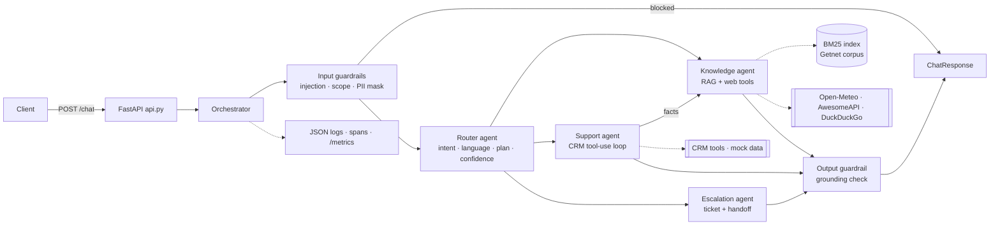

# Plan 001 — Multi-Agent Support System

## Architecture


## ADRs
- **ADR-01 Orchestration = in-process function calls over typed messages.** The Router emits a `RoutingDecision`; the Orchestrator runs the plan sequentially and passes `AgentResult` objects between agents. Rationale: deterministic, testable, traceable; a queue adds operational cost with no benefit at this scale. Swap point: `Orchestrator._run_agent`.
- **ADR-02 Two LLM providers behind `LLM` protocol.** `OfflineLLM` (rules + extractive generation, deterministic) is the default and the fallback; `AnthropicLLM` (claude-haiku-5-5 router, claude-sonnet-5-5 agents) with timeout, retries and fallback. Rationale: Article II — tests and CI never depend on a key or network.
- **ADR-03 Retrieval = BM25 with field weights (title 3×, tags 2×, text 1×), pure Python.** Corpus is tens of documents; BM25 is exact, explainable and dependency-free. Swap point: `rag/store.py` interface `search(query, lang, k)` → a vector store later.
- **ADR-04 Language-aware corpus.** Each document exists in pt and en with the same source URL; retrieval prefers the question language so even extractive (offline) answers come out in the right language.
- **ADR-05 Guardrails are rule-based first.** Regex/keyword detection for injection, PII and scope runs before any LLM (cheap, auditable); the LLM router may additionally flag `unsafe`/`out_of_scope`.
- **ADR-06 Escalation is an agent, not an error path.** It is planned by the Router (human_request, low confidence) or appended by the Orchestrator when an agent reports `needs_handoff`.
- **ADR-07 Observability with no external dependency.** JSON log lines + in-process Prometheus text exposition; OpenTelemetry can replace `observability.span` without touching agents.

## Message workflow
1. API validates `ChatRequest`, Orchestrator creates `trace_id`.
2. Input guardrails: mask PII; block injection / off-topic (route `["router"]`).
3. Router → `RoutingDecision(intent, language, plan, confidence)`; confidence < 0.45 appends escalation.
4. Agents run in plan order; Support's `facts` (terminal status, declined transactions) enrich the Knowledge query.
5. Any `needs_handoff` → Escalation runs (if not already) and opens a ticket.
6. Output guardrail checks grounding, composes the final answer in the user's language, records metrics.

## RAG pipeline
- **Ingestion** (`rag/ingest.py`): `sources.json` URLs → httpx fetch → HTML-to-text → paragraph chunks (`--refresh`); default reads the curated snapshot `data/knowledge/corpus.jsonl` (reproducible, offline).
- **Storage** (`rag/store.py`): in-memory inverted index, tokenised with accent folding and pt/en stopwords, BM25 per field.
- **Retrieval**: top-k by weighted BM25, language preference, score normalised to 0–1, threshold for "relevant".
- **Generation**: Anthropic — prompt `prompts/knowledge.md` with numbered passages, must cite `[n]`, must say "not in sources" otherwise; Offline — extractive: best sentences of the top passages, in the question language. Output grounding check on both.

## Project structure
```
src/getnet_agents/
  schemas.py config.py llm.py orchestrator.py guardrails.py observability.py api.py
  agents/ router.py knowledge.py support.py escalation.py
  rag/ ingest.py store.py
  tools/ crm.py web.py __init__.py        (Fork B)
  prompts/ router.md knowledge.md support.md escalation.md
data/knowledge (Fork A) · data/crm (Fork B) · evals (Fork C) · tests
```
